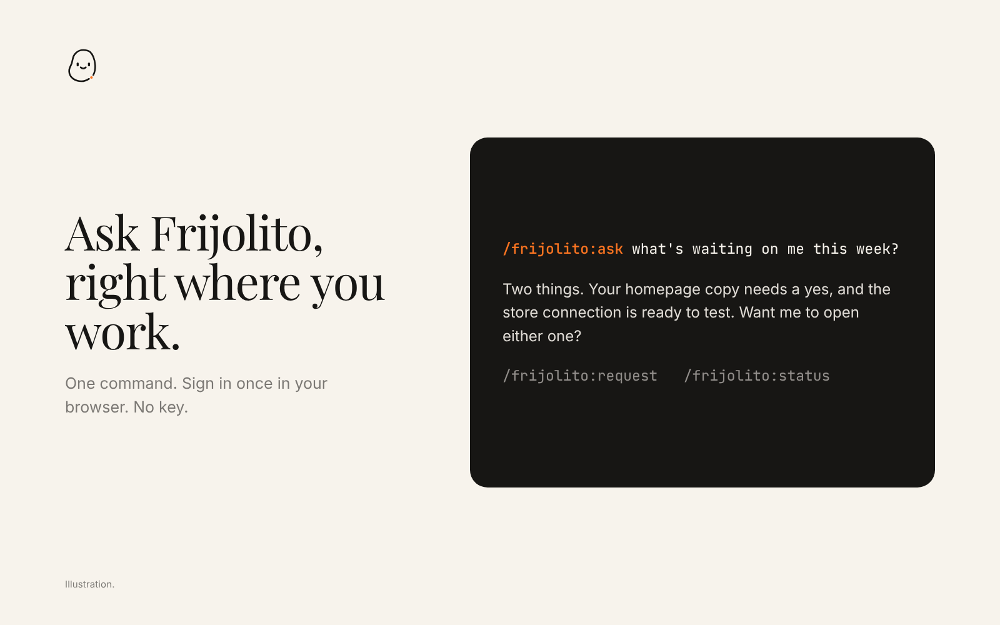
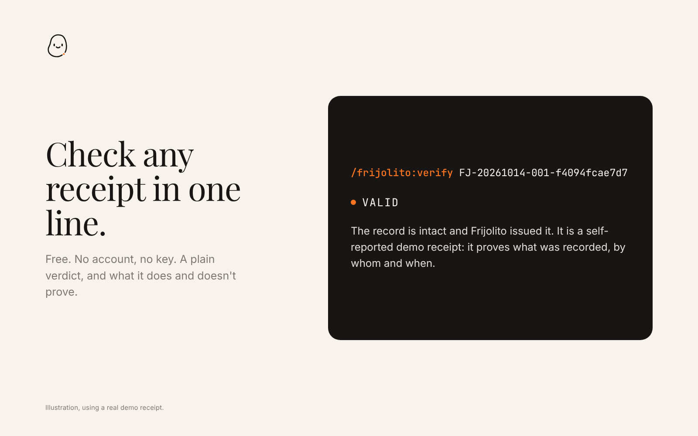

# Frijolito

Ask Frijolito, follow your requests, and verify signed receipts from Claude Code.



---

## Install

```
/plugin install frijolito --marketplace slyaidevelop/frijolito-plugins
```

On older versions of Claude Code, run `/plugin marketplace add slyaidevelop/frijolito-plugins`, then `/plugin install frijolito@frijolito`.

## First run

Nothing to set up. Verifying a receipt works right away, with no account and no key. The first time you ask Frijolito something about your account, your browser opens once to sign in.

## Commands

| Command | What it does | Needs |
|---|---|---|
| `/frijolito:ask` | Talk to Frijolito, the concierge | Sign-in |
| `/frijolito:request` | File a request with the team. Claude shows it to you first and waits for your yes | Sign-in |
| `/frijolito:status` | Your requests and open projects, with anything waiting on you at the top | Sign-in |
| `/frijolito:verify` | Check a receipt ID or hash: **VALID**, **INVALID** or **UNKNOWN** | Nothing |
| `/frijolito:notarize` | Record a moment as a signed, self-reported receipt (optional) | Receipt API key |

You can also just ask in plain language: *"Check receipt FJ-20261014-001-f4094fcae7d7."*

The account commands connect to Frijolito's MCP server at `https://frijolito.app/api/mcp` and only ever see your own account. Filing a request does not approve, build or charge anything. If the account tools go missing, run `/mcp`, choose **frijolito** and sign in again.

## Receipts

[Frijolito](https://frijolito.app) keeps signed receipts for agents and people. A receipt records a moment that a person or an agent reported, such as an agreement, an approval or a handoff, and Frijolito signs it so anyone can check later that the record is intact and that Frijolito issued it. Frijolito never moves money, holds balances or stores your documents.

There are two kinds of receipt, and they prove different things:

- **`FJ-` receipts** are self-reported. The caller tells Frijolito what happened and Frijolito signs that record. A valid `FJ-` receipt proves what was reported, by whom and when, and that it hasn't been changed since. It does not prove that the event happened or that its claims are true.
- **`FJ2-` receipts** come from a connector that reports an outside event, such as a Shopify order event, instead of from the caller. The prefix alone doesn't prove independent observation: Claude reports what each receipt's own evidence says about its source, separately from whether its signature checks out.



A VALID verdict means the record is intact and Frijolito issued it. It also says whether the receipt is sealed in a daily root anchored in Bitcoin.

This plugin is for **Claude Code**. Receipts run through a small local Python server on your computer, so the plugin is not proven to run in Claude on the web (claude.ai), and it hasn't been tested in Cowork.

## Hook receipts (optional, off by default)

With a hook receipt key, each Bash, Edit, Write and MCP call Claude Code makes opens a Frijolito receipt (`FJ-HK-…`) before it runs and closes it afterwards with a hash of the result.

- **Off until you add a key.** Without one, nothing is sent.
- **Self-reported.** Claude Code describes the call and Frijolito signs that description. Nothing witnesses the call from outside.
- **Observe only.** Frijolito never blocks or changes a call. If Frijolito can't be reached, the call goes ahead and no receipt is made.
- **What is sent.** Claude Code's hook event for that call, which includes the call's input and result. Frijolito keeps hashes and a one-line redacted summary (for example `Bash: git push origin`) and does not store the input or the result.
- **Cost.** Each matched call waits on one short request to Frijolito, usually under a second.

Hook keys are in limited release. Ask **concierge@frijolito.app** for a test key (`fjh_test_…`), then run `/plugin`, open **Frijolito**, choose **Configure** and paste it into **Hook receipt key**. Clear the field to turn hook receipts off.

The images on this page are illustrations. The receipt they show is a real demo receipt that anyone can verify.

## Safety by design

- **Nothing is minted without your yes.** Before notarizing, Claude shows you exactly what will be recorded and waits for confirmation.
- **Your document stays yours.** Claude sends only a SHA-256 fingerprint of the document when it can. If document text is sent instead, Frijolito hashes it and discards the text immediately.
- **Retries need care.** You can pass an idempotency key, and Frijolito replays the original receipt when the same key is sent again. If you don't pass one, each call gets a new key, so two calls without a key are not idempotent. If a call times out or the connection drops before Frijolito answers, the outcome is **unknown**: a receipt may or may not have been minted. The result then says `outcome_unknown` and gives back the exact key that was sent. Claude never retries on its own. If you choose to try again, reuse that key; whether Frijolito replays depends on its server still holding the first attempt, so it is not a promise of no duplicates. A new key can mint a second receipt.
- **Test keys can't make production receipts.** `fj_test_` keys mint demo receipts that are clearly marked and can never verify as production. `fj_live_` keys are refused unless you explicitly allow them.
- **Your API key is never shown.** It is kept in Claude's secure credential store and never appears in Claude's output.

## Getting a receipt API key

Asking, requests, status and verifying need no key.

To notarize, request a key from **concierge@frijolito.app**. You'll receive a test key (`fj_test_…`) to try things out, and a live key (`fj_live_…`) when you're ready for production receipts.

Then add it in Claude Code: run `/plugin`, open **Frijolito**, choose **Configure**, and paste the key into **Receipt API key**. Claude stores it in your system's secure credential store, never in a plain settings file. Restart Claude afterwards.

### Settings

| Setting | Default | Purpose |
|---|---|---|
| **Receipt API key** | (none) | Only needed to notarize. Stored securely. |
| **Allow production receipts** | Off | Turn on to let an `fj_live_` key mint production receipts. |
| **Hook receipt key** | (none) | Turns hook receipts on. Stored securely. |

## Requirements

- Claude Code.
- Python 3.9 or newer (preinstalled on macOS). No extra packages.

## Data handling

This plugin talks only to `https://frijolito.app`.

- **Asking, requests and status** go to your own Frijolito account after you sign in: what you type, and the title and summary of a request you approve.
- **Verifying** sends the receipt ID or hash you provide.
- **Notarizing** sends the party labels and roles, a short label for the moment, the name of the AI model that recorded it, and either a SHA-256 fingerprint of the document or the document text (which Frijolito hashes and discards right away). Optional evidence pointers and a reference ID are sent only if you provide them.
- Receipts are public by design: anyone with a receipt ID can verify it and see its parties and label. Don't put anything in a party label or moment label that you wouldn't want a verifier to see.
- No data is sent to anyone other than Frijolito, and the plugin stores nothing on your computer. Hook receipts send nothing unless you add a hook receipt key. Your keys are kept in Claude's secure credential store.

See Frijolito's [privacy policy](https://frijolito.app/privacy) and [terms](https://frijolito.app/terms).

## Support

Questions, key requests or problems: **concierge@frijolito.app** · [frijolito.app](https://frijolito.app)

## License

[MIT](LICENSE) © 2026 Frijolito
